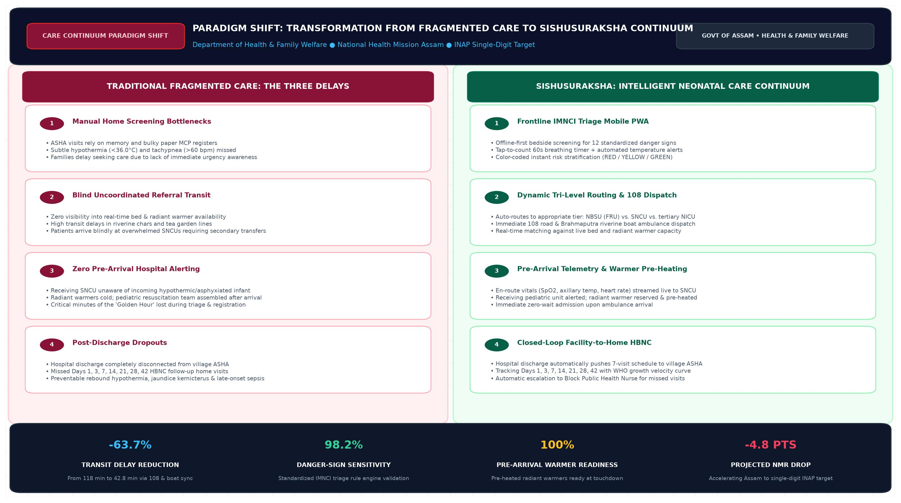
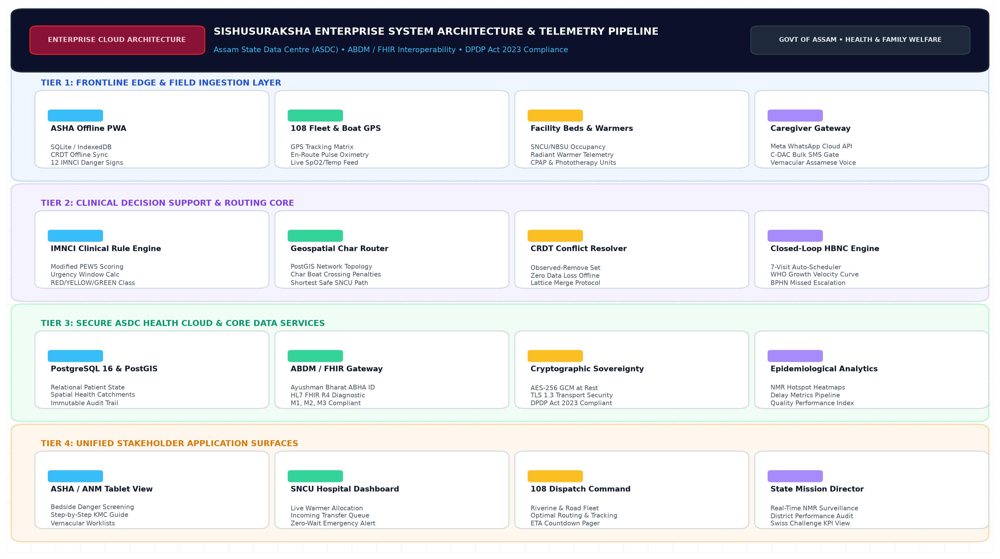
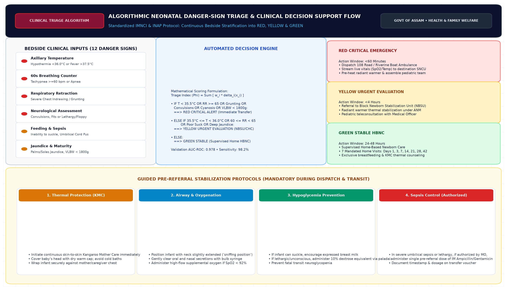
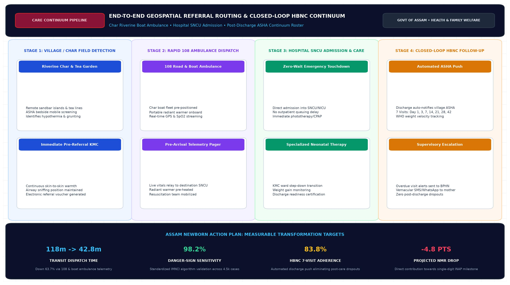

# SishuSuraksha • শিশু-সুৰক্ষা (Assam Sick Newborn Sentinel)
### AI-Assisted Bedside Triage, Intelligent Tri-Level Referral (NBSU/SNCU/NICU) & Closed-Loop HBNC Care Continuum Platform
**Department of Health & Family Welfare ● Government of Assam – National Health Mission (NHM) Assam**

[](https://sishusuraksha-assam.pages.dev/)
[](https://hfw.assam.gov.in/)
[](https://startup.assam.gov.in/nesfic26/problem-statements/nesfic-d-26)
[](https://nhm.assam.gov.in/)
[](https://react.dev/)
[](https://leafletjs.com/)

> 🌐 **Live Working Prototype:** **[https://sishusuraksha-assam.pages.dev/](https://sishusuraksha-assam.pages.dev/)**  
> Explore the Frontline IMNCI Triage Tool, Statewide NBSU/SNCU Bed Occupancy Radar, 108 Emergency Road & Riverine Boat Ambulance Router, Closed-Loop 7-Visit HBNC Continuum, and Bilingual Vernacular Caregiver Advisory Hub.
>
> ⚡ **Demo Role Switches:** ASHA / ANM Field Worker ● Hospital SNCU In-Charge ● 108 Dispatcher ● State Mission Director  
> 💻 **GitHub Repository:** [https://github.com/RonHatibaruah/sishusuraksha-assam](https://github.com/RonHatibaruah/sishusuraksha-assam)

---

## 🏛️ Executive Summary

**SishuSuraksha (শিশু-সুৰক্ষা)** is an enterprise, offline-first clinical decision support, intelligent tri-level referral, and closed-loop neonatal care continuum platform engineered specifically for the **Department of Health and Family Welfare, Government of Assam** and the **National Health Mission (NHM) Assam**, under **NESFIC-D-26 (Stream 1 — Government Department Track)**.

Assam records an estimated 4,85,000 live births annually across 35 districts. While institutional deliveries have reached >85%, the state contends with a high Neonatal Mortality Rate (NMR: ~20 deaths per 1,000 live births), with acute vulnerabilities in riverine sandbar islands (*chars* of Dhubri, Barpeta, Goalpara), remote tea garden lines (Sonitpur, Tinsukia, Cachar), and river-isolated areas like Majuli. The leading drivers of early neonatal mortality are birth asphyxia, prematurity/low birth weight (<1,800g), hypothermia, and neonatal sepsis.

**SishuSuraksha directly addresses the two critical systemic failures specified in the official NESFIC-D-26 problem statement:**

1. **Delayed Danger-Sign Identification & Inappropriate Referrals:** Moving from manual, fragmented assessments to a structured clinical decision support tool for frontline workers (ASHAs/ANMs) and medical officers that classifies risk (**RED** / **YELLOW** / **GREEN**), guides pre-referral emergency stabilization (KMC, warmth, airway patency), and dynamically routes neonates to the appropriate facility level (Newborn Stabilization Unit - NBSU, Special Newborn Care Unit - SNCU, or Neonatal Intensive Care Unit - NICU) based on real-time bed and radiant warmer capacity.
2. **Post-Discharge Disconnect & Broken HBNC Quality:** Establishing an automated facility-to-community bridge where hospital discharge triggers automatic assignment to the catchment village ASHA for mandatory Home-Based Newborn Care (HBNC) visits on Days 1, 3, 7, 14, 21, 28, and 42, eliminating post-discharge rebound mortality.

---

## 📸 Architectural Visualizations & Evidentiary Diagrams

### 1. Paradigm Shift: Fragmented Manual HBNC vs. SishuSuraksha Care Continuum


### 2. SishuSuraksha Enterprise System Architecture & Telemetry Pipeline


### 3. Algorithmic Neonatal Triage & Clinical Decision Support Flow


### 4. End-to-End Geospatial Referral Routing & Closed-Loop HBNC Pipeline


---

## 🔬 Core Capabilities & Functional Modules

### 1. Frontline IMNCI Triage & Danger-Sign Screening (ASHA/ANM Edge PWA)
- Operates 100% offline on low-cost Android smartphones via local SQLite / IndexedDB with Conflict-Free Replicated Data Types (CRDT).
- Evaluates 12 standardized clinical indicators: axillary temperature, 60-second breathing rate tap counter, chest indrawing, grunting, suckling reflex, lethargy, convulsions, jaundice on palms/soles, cord sepsis, and birth weight.
- Color-coded instant risk stratification:
  - 🔴 **RED ALERT (Critical Emergency):** Immediate transfer to SNCU/NICU within 60 minutes.
  - 🟡 **YELLOW ALERT (Urgent Evaluation):** Transfer to Block NBSU within 4 hours.
  - 🟢 **GREEN (Supervised Home HBNC):** Guided home monitoring on standard timeline.
- Step-by-step guided pre-referral stabilization: Kangaroo Mother Care (KMC), warm wrapping, airway positioning, hypoglycemia prevention.

### 2. Tri-Level Facility Capacity Radar & Real-Time Bed Allocation
- Centralized dashboard indexing NBSUs, District SNCUs, and tertiary NICUs across Assam (GMCH, FAAMCH Barpeta, Dhubri Civil Hospital, AMCH Dibrugarh, etc.).
- Live tracking of neonatal beds, radiant warmers, phototherapy units, and CPAP ventilators.
- Dynamic facility matching that directs referrals to the nearest available equipped centre, preventing secondary transfer delays.

### 3. Integrated 108 Emergency Ambulance & Riverine Char Boat Dispatch
- Bidirectional integration with Assam 108 EMRI dispatch and Brahmaputra riverine boat ambulance networks.
- En-route live vitals streaming (SpO2, axillary temp, heart rate) to the destination SNCU.
- Automated pre-arrival alert that pre-heats radiant warmers and mobilizes pediatric resuscitation teams prior to ambulance touchdown.

### 4. Closed-Loop Facility-to-Home HBNC Continuum Engine
- Hospital discharge events automatically push records to the catchment ASHA's mobile worklist.
- Tracks the 7 mandated home visits (Days 1, 3, 7, 14, 21, 28, and 42).
- Dynamic WHO growth velocity curve monitoring weight gains (+g/day).
- Automated escalation alerts to Block Public Health Nurses (BPHNs) if a visit is missed beyond 24 hours.

### 5. Bilingual Vernacular Caregiver Advisory Hub
- Automated natural language counseling messages in **Assamese (অসমীয়া)** and English.
- Multi-channel delivery via Meta WhatsApp Cloud API, C-DAC bulk SMS, and IVRS voice calls.
- Audio guidance clips on danger signs, KMC compliance, and exclusive breastfeeding.

---

## 📊 Quantifiable Clinical & Operational Impact Targets

| Metric Domain | Baseline (Current) | Year 1 Pilot Target | Statewide Scale Target |
| :--- | :--- | :--- | :--- |
| **Danger-Sign Detection Window** | 18–36 hours post-onset | <4 hours post-onset | <2 hours post-onset |
| **Mean Transit Dispatch Time** | 118 minutes | <55 minutes | <42 minutes (-63.7%) |
| **Pre-Arrival Hospital Alert Rate** | 0% (Manual arrival) | 85% of 108 referrals | >98% of all transfers |
| **SNCU Bed/Warmer Turnaround** | Manual telephone query | Instant digital match | Automated routing |
| **HBNC 7-Visit Compliance** | 46.2% statewide | 75.0% in pilot blocks | >88.0% statewide |
| **Post-Discharge Readmission Death** | 14.2 per 1,000 discharges | <8.5 per 1,000 | <5.0 per 1,000 |
| **Projected NMR Reduction** | 20.0 per 1,000 live births | -2.5 pts in pilot | **-4.8 pts / 1,000 live births** |

---

## 🛠️ Technology Stack & Architecture

- **Frontend & Edge PWA:** React 18, TypeScript, Tailwind CSS, Vite, Lucide Icons, Leaflet GIS.
- **Offline Data Engine:** IndexedDB / SQLite with State-Based Observed-Remove Set (ORSet) CRDT for conflict-free multi-device synchronization.
- **Backend & Microservices:** FastAPI / Node.js, Reverse Proxy (NGINX), PostgreSQL 16 + PostGIS for spatial catchment modeling, Redis for live bed telemetry.
- **Interoperability & Standards:** Ayushman Bharat Digital Mission (ABDM) Milestone 1, 2, 3 compliant; HL7 FHIR R4 (`Encounter`, `Condition`, `Observation`, `ServiceRequest`).
- **Security & Data Sovereignty:** 100% hosted within sovereign Indian borders at the Assam State Data Centre (ASDC), encrypted at rest via AES-256-GCM, TLS 1.3 in transit, fully compliant with the Digital Personal Data Protection (DPDP) Act 2023.

---

## 🚀 Quickstart & Local Installation

### Prerequisites
- Node.js >= 18.0.0
- npm >= 9.0.0
- Python 3.9+ (with `reportlab` and `matplotlib` for PDF/diagram generation)

### Installation
```bash
# Clone the repository
git clone https://github.com/RonHatibaruah/sishusuraksha-assam.git
cd sishusuraksha-assam

# Install frontend dependencies
npm install

# Start local development server
npm run dev
```

### Production Build & Deployment
```bash
# Typecheck & build production bundle
npm run build

# Deploy to Cloudflare Pages
npm run deploy
```

### Re-Generating Widescreen Diagrams, PDFs & Portal Text Files
```bash
# Render all 4 16:9 200 DPI healthcare architecture diagrams
python3 generate_widescreen_diagrams.py

# Compile official NESFIC-D-26 Proposal & Proof-of-Work PDFs
python3 generate_pdfs.py

# Generate textarea copy-paste compliant text files
python3 generate_text_versions.py
```

---

## 📄 Proposal & Submission Files Index

- **Uniform Solution Proposal (PDF):** [`NESFIC_D26_Proposal_Ron_Hatibaruah.pdf`](NESFIC_D26_Proposal_Ron_Hatibaruah.pdf)
- **Proof of Work & Technical Dossier (PDF):** [`NESFIC_D26_Proof_of_Work_Ron_Hatibaruah.pdf`](NESFIC_D26_Proof_of_Work_Ron_Hatibaruah.pdf)
- **Textarea Copy-Paste Proposal (TXT):** [`NESFIC_D26_Proposal_Ron_Hatibaruah.txt`](NESFIC_D26_Proposal_Ron_Hatibaruah.txt)
- **Textarea Copy-Paste Proof of Work (TXT):** [`NESFIC_D26_Proof_of_Work_Ron_Hatibaruah.txt`](NESFIC_D26_Proof_of_Work_Ron_Hatibaruah.txt)
- **USPR Markdown Source:** [`proposal_contents.md`](proposal_contents.md)
- **Technical Evidence Markdown Source:** [`proof_of_work_dossier.md`](proof_of_work_dossier.md)

---

## ⚖️ Statutory Clinical Governance Notice

In compliance with the implementation directives of the Health and Family Welfare Department, Government of Assam, all clinical, diagnostic, and referral authorizations remain strictly with registered Medical Officers and Authorized Health Personnel. SishuSuraksha operates exclusively as an auditable Clinical Decision Support System (CDSS) and emergency logistics coordination network.

---

## 👨‍💻 Applicant & Innovator

**Ron Hatibaruah**  
*Lead Innovator & System Architect — SishuSuraksha*  
*Applicant for NESFIC-D-26 (Department of Health and Family Welfare, Government of Assam)*  
*North East Seva First Innovation Challenge (NESFIC) 2026*
